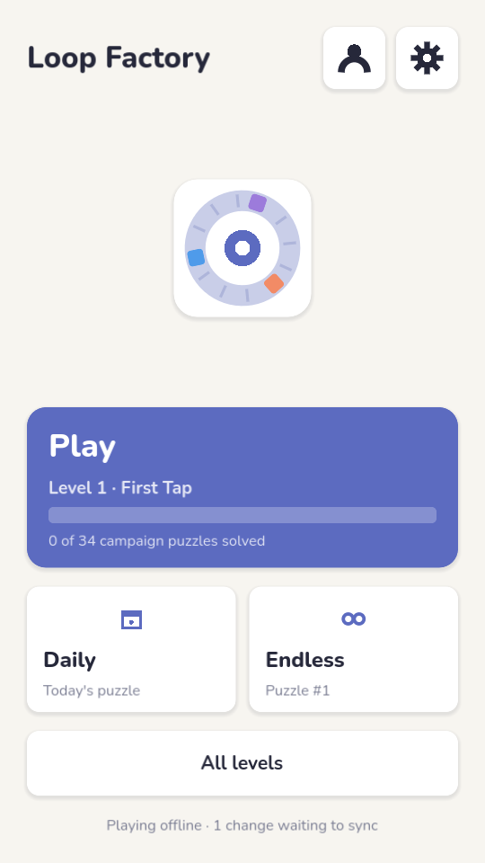
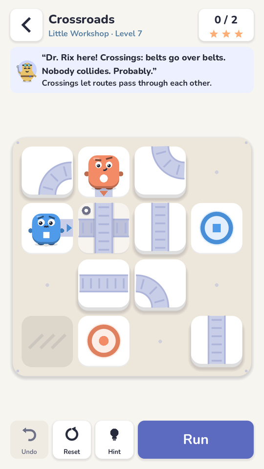
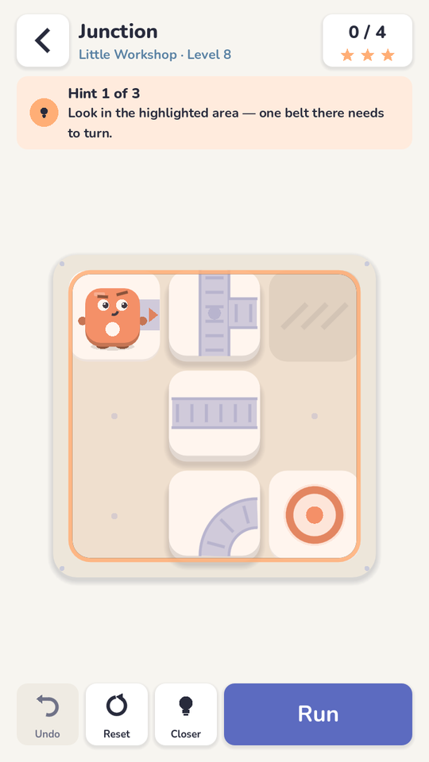
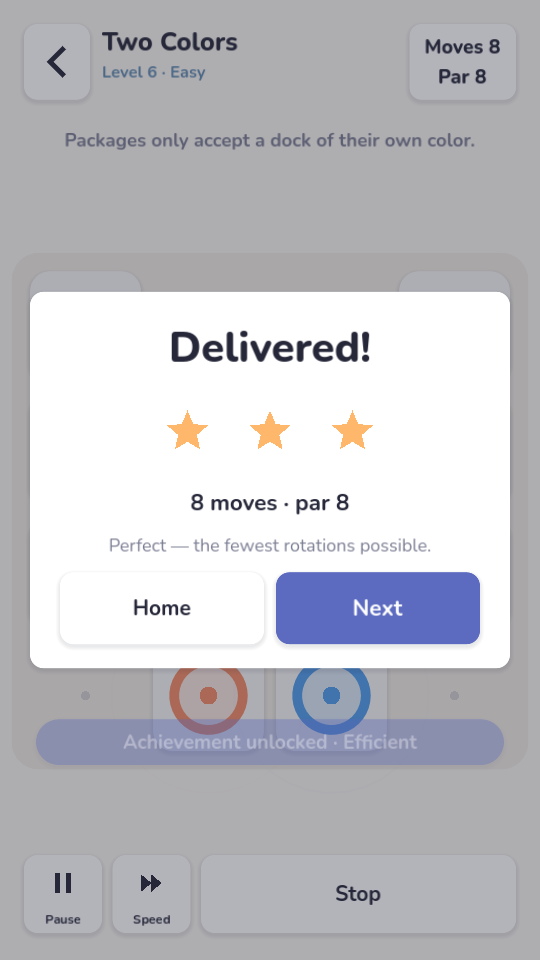
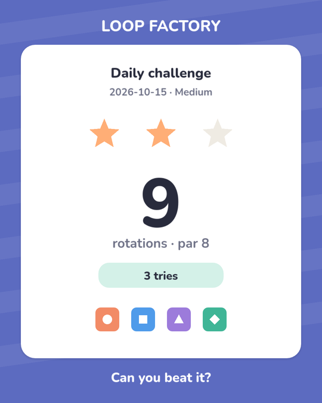
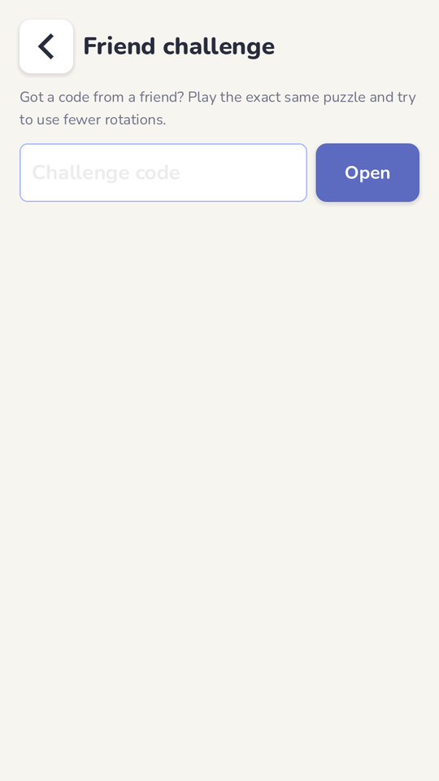
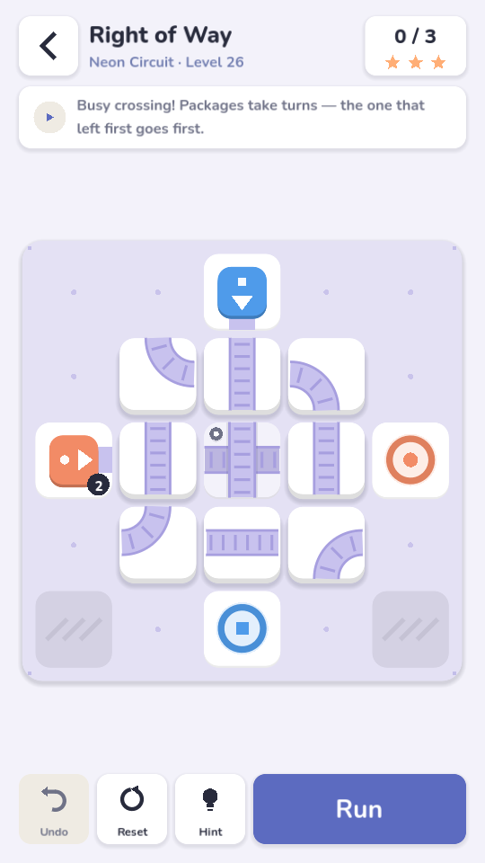
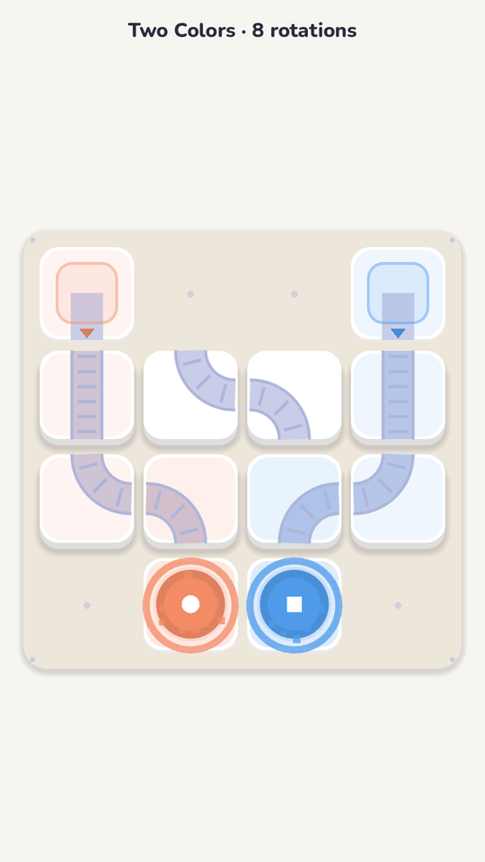
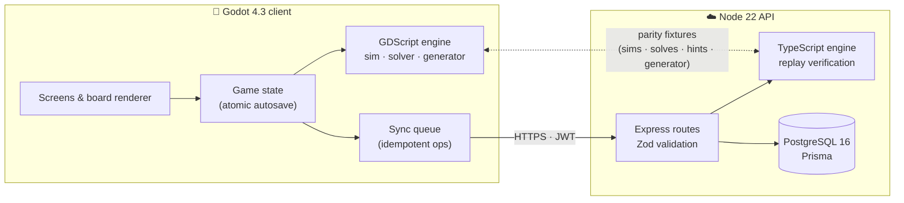

<p align="center">
  
</p>

<p align="center">
  <a href=".github/workflows/ci.yml"></a>
  
  
  
  
  
  
</p>

<p align="center">
  <b>Tap a belt to turn it. Press Run. Watch every package glide home.</b><br>
  A tactile conveyor-belt puzzle game built for one-minute breaks — fully offline, instant resume,<br>
  starring <b>the Interdimensional Delivery Crew</b>: packages with personalities, supervised by a very sleepy space cat.
</p>

<p align="center">
  
</p>

---

## Contents

- [Highlights](#highlights)
- [How it plays](#how-it-plays)
- [Architecture](#architecture)
- [Quick start](#quick-start)
- [Project status](#project-status)
- [Repository map](#repository-map)
- [Documentation](#documentation)
- [Contributing](#contributing)

## Highlights

| | |
|---|---|
| 📦 **The Interdimensional Delivery Crew** | Packages are characters — overconfident Bloop, nervous Zip, chaotic Glitch, sleepy Mochi — who react to every route; Captain Naps supervises (barely) and Dr. Rix introduces new machinery. Same rules, same symbols, never in the way ([character system](docs/CHARACTER_SYSTEM.md)) |
| 🎩 **Looks you earn** | 15 cosmetic looks and a starry-eyed celebration unlock through normal play — nothing to buy, never covering a colour or symbol |
| ✨ **Satisfying to touch** | Tiles sink and pre-tilt under your finger, snap in 140 ms, belts roll under packages, paths light up, docks pop — and a skippable 1.2 s celebration ([game feel](docs/game-feel.md)) |
| 🧩 **36 curated puzzles, 5 worlds** | Little Workshop → Candy Factory → Parcel Station → Neon Circuit → Space Logistics; a CI-enforced [difficulty model](docs/difficulty.md) keeps the curve fair |
| 🤝 **Friend challenges** | Share a code, a friend plays the same puzzle with no sign-up, and the server verifies who used fewer rotations ([sharing](docs/sharing.md)) |
| 🎓 **Learn by doing** | An interactive coach for levels 1–5 and three-step hints (area → tile → rotation) from a verified optimal solution |
| ♾️ **Endless & daily** | Procedural generator across 5 tiers (1,000-puzzle property test); one HMAC-seeded daily for everyone, with a shareable result card |
| 🎯 **Exact solver** | Minimum-rotation search, cross-checked against brute force; powers hints and level validation |
| ⚖️ **Fair leaderboards** | Scores come from server re-simulation of move replays — never from client counters |
| 📴 **Offline-first** | Atomic autosave after every move, instant resume, corrupted-save recovery, idempotent sync queue |
| 🔁 **One rules engine, two runtimes** | TypeScript (server) and GDScript (device) proven identical on 180 simulations, every curated solve and hint, and 15 generated levels |
| ♿ **Accessible** | One-handed play, shapes on every package (never colour alone), reduced motion, separate sound / music / vibration, character animation and chatter toggles |
| 🔒 **Privacy by design** | No sign-up, opt-in analytics, random ids, privacy-safe A/B bucketing, in-app data export and account deletion |

## How it plays

<table>
<tr>
<td align="center" width="25%"><br><sub><b>Meet Captain Naps</b><br>The supervisor. Mostly asleep. Tap for a line</sub></td>
<td align="center" width="25%"><br><sub><b>The Crew</b><br>Bloop, Zip, Glitch, Mochi, Captain Naps, Dr. Rix</sub></td>
<td align="center" width="25%"><br><sub><b>Looks you earn</b><br>Preview every animation; unlock looks by playing</sub></td>
<td align="center" width="25%"><br><sub><b>Dr. Rix explains</b><br>New machinery, introduced in one optional line</sub></td>
</tr>
<tr>
<td align="center" width="25%"><br><sub><b>Learn by doing</b><br>A coach shows where to tap on the first levels</sub></td>
<td align="center" width="25%"><br><sub><b>Hints that teach</b><br>Area first, then the tile, then the turn</sub></td>
<td align="center" width="25%"><br><sub><b>Watch it run</b><br>Belts roll, routes light up in package colours</sub></td>
<td align="center" width="25%"><br><sub><b>Failures that explain</b><br>Who, why, and where — never over the board</sub></td>
</tr>
<tr>
<td align="center"><br><sub><b>A rewarding finish</b><br>Everyone celebrates on their dock — tap to skip</sub></td>
<td align="center"><br><sub><b>One big Next</b><br>Stars one by one; Captain Naps reacts to what happened</sub></td>
<td align="center"><br><sub><b>Share without spoilers</b><br>Result, stars and a crew reaction — never the solution</sub></td>
<td align="center"><br><sub><b>Challenge a friend</b><br>Same puzzle, verified head-to-head</sub></td>
</tr>
<tr>
<td align="center"><br><sub><b>Five worlds</b><br>Each introduces one idea at a time</sub></td>
<td align="center"><br><sub><b>Themed boards</b><br>Palettes change, readability doesn't</sub></td>
<td align="center"><br><sub><b>Replays</b><br>Clean portrait view for screen recording</sub></td>
<td align="center"><br><sub><b>Daily puzzle</b><br>Clearly-labelled practice when offline</sub></td>
</tr>
</table>

**Rules in one breath:** packages leave sources, follow belts (junctions go straight, else turn right,
else left), wait their turn at busy tiles, and must all reach a dock of their own colour. Fewest
rotations wins. Full normative rules: [docs/gameplay-rules.md](docs/gameplay-rules.md).

## Architecture



- **Canonical rules** live in [`packages/engine`](packages/engine); the device mirror is in
  [`apps/game/scripts/engine`](apps/game/scripts/engine).
- **API contracts** are Zod schemas in [`packages/contracts`](packages/contracts); the same declarations
  validate requests and generate the [OpenAPI 3.1 spec](docs/api/openapi.json).
- More in [docs/architecture.md](docs/architecture.md) and [docs/sync.md](docs/sync.md).

## Quick start

**Prerequisites:** Node 22, Godot 4.3, and PostgreSQL 16 *or* Docker.

```bash
git clone <this repo> && cd loopfactory-
npm ci

# Backend: database + API on http://localhost:8080  (spec at /openapi.json)
docker compose up --build

# Game: open apps/game in the Godot 4.3 editor and press ▶
#        (no server? it just plays offline)
```

<details>
<summary><b>Run the API without Docker</b></summary>

```bash
cp .env.example .env
export $(grep -v '^#' .env | xargs)
npx prisma migrate deploy --schema database/schema.prisma
npm run db:seed -w @loopfactory/api
npm run dev -w @loopfactory/api
```
</details>

<details>
<summary><b>Everyday commands</b></summary>

| Command | Purpose |
|---|---|
| `npm run typecheck` · `npm run lint` | Static checks |
| `npm test -w @loopfactory/engine` | Rules-engine tests |
| `npm test -w @loopfactory/api` | API integration tests (Postgres; `TEST_DATABASE_URL`) |
| `./scripts/test-game.sh` | Godot tests — parity, rules, saves, UI layout & feel |
| `./scripts/e2e.sh` | Real client ↔ real API end-to-end |
| `npm run levels:build -- --review` | Rebuild curated levels, print ASCII renders |
| `npm run fixtures:build` | Regenerate TS → GDScript parity fixtures |
| `npm run openapi -w @loopfactory/api` | Regenerate `docs/api/openapi.json` |
| `./scripts/build-android.sh debug\|release` | Export Android APKs |
| `godot --path apps/game -- --tour=/abs/dir` | Screenshot tour of every screen |
| `xvfb-run godot --path apps/game --rendering-driver opengl3 -s res://tests_ui/bench_board.gd` | Board rendering benchmark |
</details>

## Project status

| Area | Status |
|---|---|
| Core game loop, 36 levels in 5 worlds, endless, offline play, resume | ✅ Done & tested |
| Game feel, onboarding, hints, failure feedback, celebration, audio | ✅ Done & tested on desktop · ⚠️ feel not yet play-tested on a phone |
| Friend challenges, share card, replays, experiments, analytics taxonomy | ✅ Done & tested · consent asked after the first delivery, consent-anchored cohorts · ⚠️ native share / App Link plugin written but not compiled or device-tested · ⏳ video export not built |
| Interdimensional Delivery Crew: characters, Captain Naps, Dr. Rix, dialogue, The Crew, looks, flags | ✅ Done & tested on desktop · ⚠️ v1 procedural art (no illustrator pass), not tested on a phone, effect on retention unmeasured |
| Backend: auth, sync, daily, challenges, leaderboards, achievements, privacy | ✅ Done & tested · concurrency-safe score writes, lost-response token recovery, NAT-safe rate limits (real-Postgres tests) |
| CI, Docker image, Render blueprint, load test | ✅ Done (not deployed) |
| Android debug APK (Godot 4.5.1: 16 KB-aligned arm64 libs) | ✅ Built; packaged config and alignment verified · ⚠️ not installed on a device |
| Play Store AAB (target API 36), release signing | ⏳ Pipeline and validation ready; needs Android SDK platform 36, an HTTPS host and the upload key · not uploaded |
| iOS build | ⏳ Needs macOS + Xcode |
| Google/Apple sign-in, store billing, ads, native crash capture | ⏳ Interfaces ready, credentials/plugins pending (local diagnostics boundary active) |

**Beta readiness:** [docs/BETA_READINESS_IMPLEMENTATION.md](docs/BETA_READINESS_IMPLEMENTATION.md)
— audit resolution matrix, evidence, device QA checklist, blockers. Verdict: **ready for internal
device testing** (not yet a closed beta).

**Verification (latest run, Godot 4.3 and 4.5.1):** engine 46/46 (incl. 1,000 generated puzzles) ·
Godot 59 tests / 7,771 assertions · auth 32 · analytics 74 · UI 301 checks on 5 aspect ratios · crew
scene tests 201 · beta flows 173 · API 70/70 (real Postgres, incl. concurrency and rate limits) ·
end-to-end 28/28 · typecheck, lint, config rules and production `npm audit` clean. Details in
[docs/testing.md](docs/testing.md) and [docs/load-testing.md](docs/load-testing.md).
Everything not finished is listed honestly in [docs/known-limitations.md](docs/known-limitations.md).

## Repository map

```
apps/game/            Godot client — engine port, autoloads, UI, tests, export presets
services/api/         REST API — routes, services, scripts, integration tests
packages/engine/      Canonical rules engine + curated level data
packages/contracts/   Shared Zod schemas + achievement definitions
database/             Prisma schema and SQL migrations
infrastructure/       Docker image
scripts/              Level/fixture builders, test runners, Android build, load test
docs/                 Design, operations, release and policy documents
```

Each package has its own README: [game](apps/game/README.md) ·
[api](services/api/README.md) · [engine](packages/engine/README.md) ·
[contracts](packages/contracts/README.md) · [database](database/README.md) ·
[scripts](scripts/README.md).

## Documentation

| | |
|---|---|
| **Characters** | [Character system](docs/CHARACTER_SYSTEM.md) · [Art guide](docs/CHARACTER_ART_GUIDE.md) · [Animations](docs/CHARACTER_ANIMATIONS.md) · [Testing](docs/CHARACTER_TESTING.md) |
| **Design** | [Gameplay rules](docs/gameplay-rules.md) · [Game feel](docs/game-feel.md) · [Difficulty model](docs/difficulty.md) · [Architecture](docs/architecture.md) · [Sync & persistence](docs/sync.md) |
| **Backend** | [API overview](docs/api.md) · [OpenAPI spec](docs/api/openapi.json) · [Security review](docs/security.md) |
| **Operations** | [Deployment, backups, rollback](docs/deployment.md) · [Load testing](docs/load-testing.md) · [Performance](docs/performance.md) · [Testing](docs/testing.md) |
| **Product** | [Analytics & queries](docs/analytics.md) · [Experiments](docs/experiments.md) · [Sharing & challenges](docs/sharing.md) · [Monetisation](docs/monetization.md) · [Store listing](docs/store-listing.md) · [Privacy policy](docs/privacy-policy.md) |
| **Upgrade** | [Upgrade audit](docs/UPGRADE_AUDIT.md) — what was found and what changed · [Beta readiness](docs/BETA_READINESS_IMPLEMENTATION.md) — production fixes and Android beta status |
| **Release** | [Android](docs/release-android.md) · [iOS](docs/release-ios.md) · [Known limitations](docs/known-limitations.md) · [Changelog](CHANGELOG.md) |

## Contributing

See [CONTRIBUTING.md](CONTRIBUTING.md) — especially the rule that any change to game rules must land
in **both** engines with regenerated parity fixtures. Security issues: [SECURITY.md](SECURITY.md).

## License

Proprietary — all rights reserved (no open-source license has been chosen yet). The Nunito font is
under the SIL Open Font License 1.1 ([`apps/game/assets/fonts/OFL.txt`](apps/game/assets/fonts/OFL.txt)).
All artwork and sound effects are original and generated in code.
