<p align="center">
  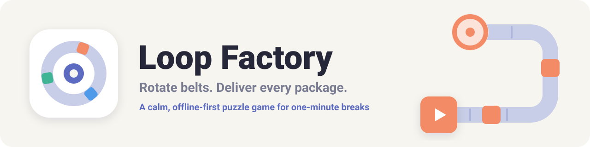
</p>

<p align="center">
  <a href=".github/workflows/ci.yml"></a>
  
  
  
  
  
  
</p>

<p align="center">
  <b>Tap a belt to turn it. Press Run. Watch every package glide home.</b><br>
  A minimalist conveyor-belt puzzle game built for one-minute breaks — fully offline, instant resume,<br>
  and a daily puzzle where every leaderboard score is re-verified by the server.
</p>

<p align="center">
  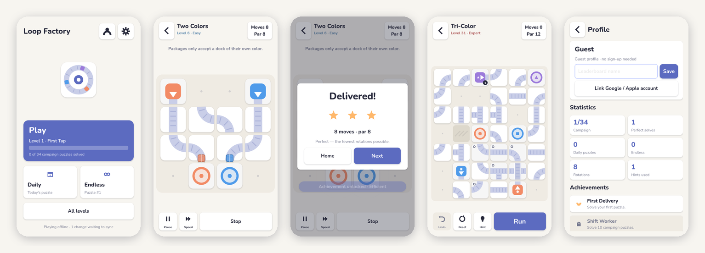
</p>

---

## Contents

- [Highlights](#highlights)
- [How it plays](#how-it-plays)
- [Architecture](#architecture)
- [Quick start](#quick-start)
- [Project status](#project-status)
- [Repository map](#repository-map)
- [Documentation](#documentation)
- [Contributing](#contributing)

## Highlights

| | |
|---|---|
| 🧩 **34 curated puzzles** | 9 hand-designed teaching levels + 25 reviewed generator levels, each with a solver-proven *par* |
| ♾️ **Endless & daily** | Procedural generator across 5 difficulty tiers; one HMAC-seeded daily puzzle for everyone |
| 🎯 **Exact solver** | Minimum-rotation search, cross-checked against brute force; powers hints and level validation |
| ⚖️ **Fair leaderboards** | Scores come from server re-simulation of move replays — never from client counters |
| 📴 **Offline-first** | Atomic autosave after every move, instant resume, corrupted-save recovery, idempotent sync queue |
| 🔁 **One rules engine, two runtimes** | TypeScript (server) and GDScript (device) proven byte-identical by ~1,700 parity assertions |
| ♿ **Accessible** | One-handed play, long-press to rotate back, colour symbols, reduced motion, haptics |
| 🔒 **Privacy by design** | No sign-up, opt-in analytics, random ids, in-app data export and account deletion |

## How it plays

<table>
<tr>
<td align="center" width="25%">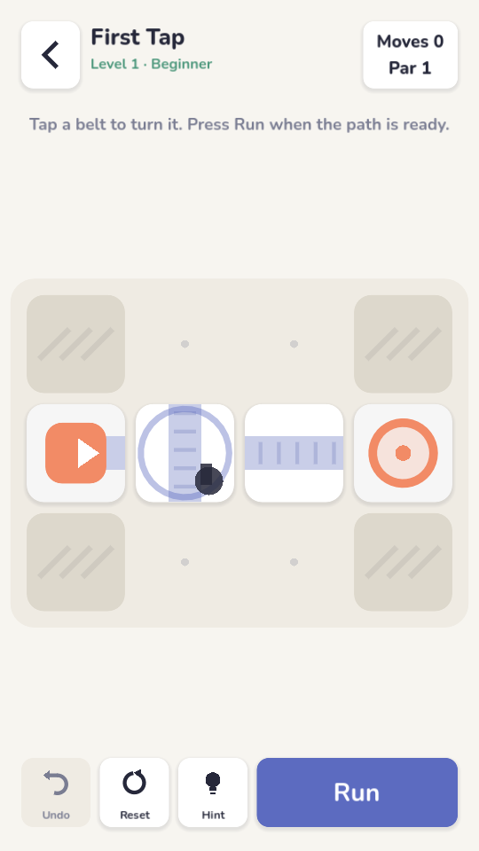<br><sub><b>Learn by doing</b><br>The first level shows exactly where to tap</sub></td>
<td align="center" width="25%">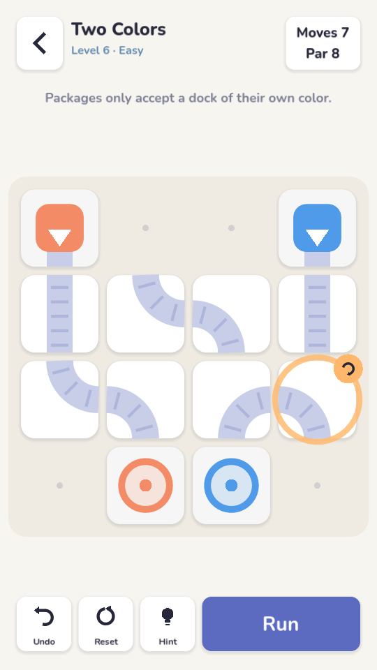<br><sub><b>Hints when you want them</b><br>The next tile and which way to turn it</sub></td>
<td align="center" width="25%">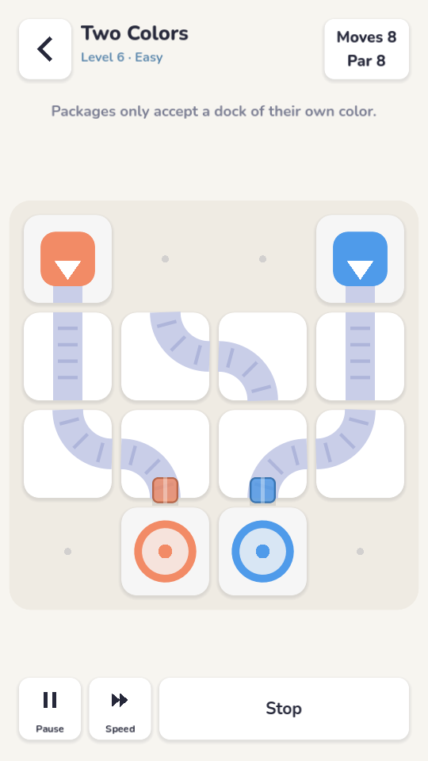<br><sub><b>Deterministic runs</b><br>Pause or speed up — results never change</sub></td>
<td align="center" width="25%">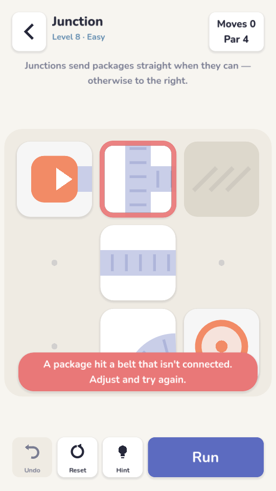<br><sub><b>Friendly failures</b><br>Clear reason, rotations kept, retry instantly</sub></td>
</tr>
<tr>
<td align="center">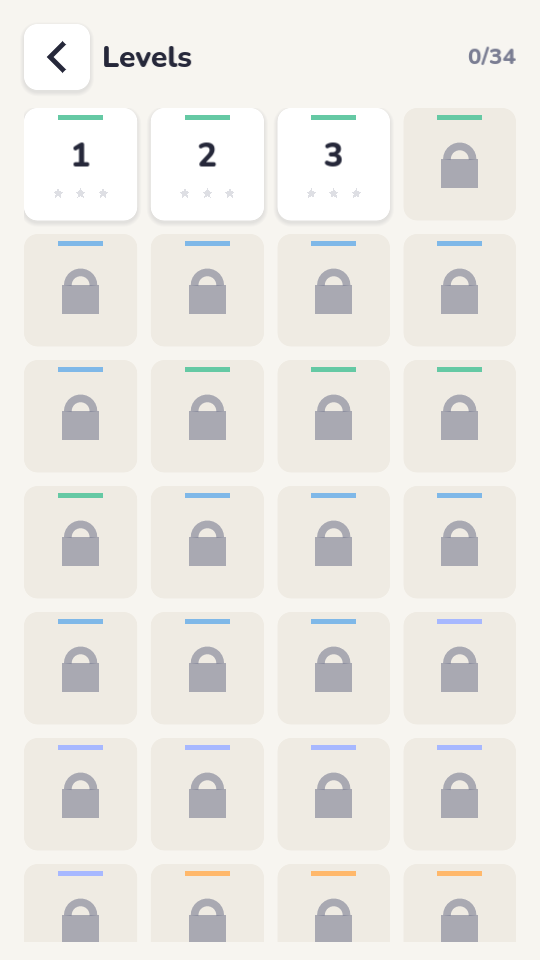<br><sub><b>Progressive unlocks</b><br>Three unsolved levels always open</sub></td>
<td align="center">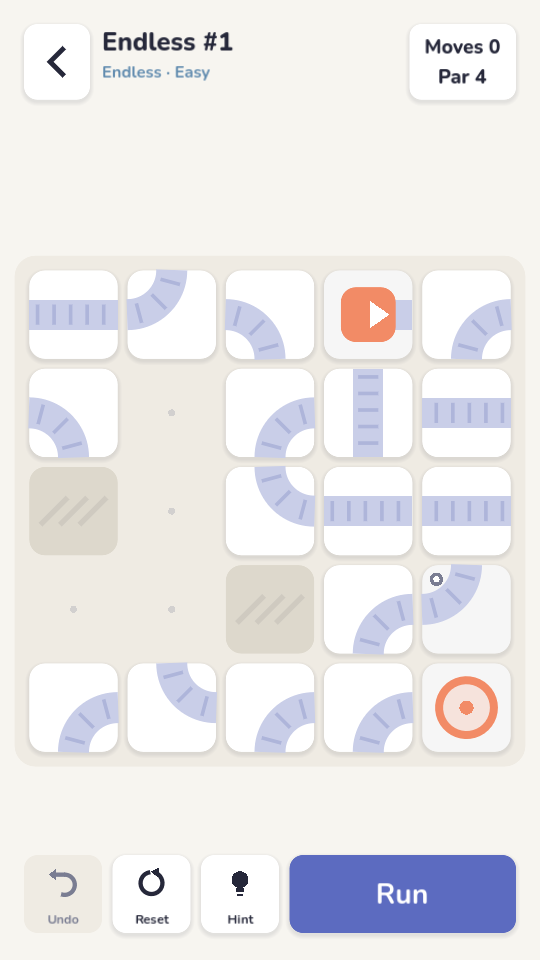<br><sub><b>Endless mode</b><br>Fresh verified puzzles, ramping difficulty</sub></td>
<td align="center">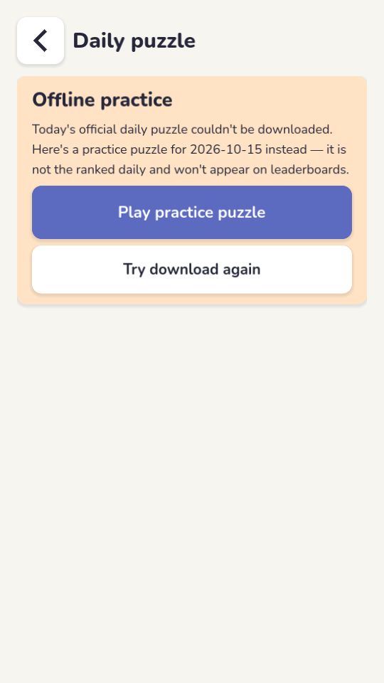<br><sub><b>Daily puzzle</b><br>Clearly-labelled practice when offline</sub></td>
<td align="center">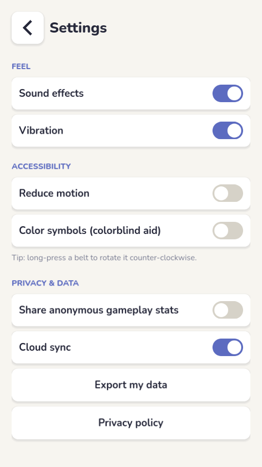<br><sub><b>Your controls</b><br>Accessibility, privacy, data export</sub></td>
</tr>
</table>

**Rules in one breath:** packages leave sources, follow belts (junctions go straight, else turn right,
else left), wait their turn at busy tiles, and must all reach a dock of their own colour. Fewest
rotations wins. Full normative rules: [docs/gameplay-rules.md](docs/gameplay-rules.md).

## Architecture

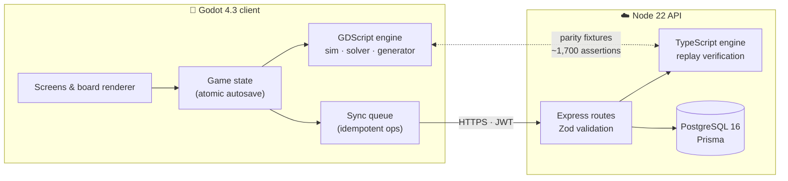

- **Canonical rules** live in [`packages/engine`](packages/engine); the device mirror is in
  [`apps/game/scripts/engine`](apps/game/scripts/engine).
- **API contracts** are Zod schemas in [`packages/contracts`](packages/contracts); the same declarations
  validate requests and generate the [OpenAPI 3.1 spec](docs/api/openapi.json).
- More in [docs/architecture.md](docs/architecture.md) and [docs/sync.md](docs/sync.md).

## Quick start

**Prerequisites:** Node 22, Godot 4.3, and PostgreSQL 16 *or* Docker.

```bash
git clone <this repo> && cd loopfactory-
npm ci

# Backend: database + API on http://localhost:8080  (spec at /openapi.json)
docker compose up --build

# Game: open apps/game in the Godot 4.3 editor and press ▶
#        (no server? it just plays offline)
```

<details>
<summary><b>Run the API without Docker</b></summary>

```bash
cp .env.example .env
export $(grep -v '^#' .env | xargs)
npx prisma migrate deploy --schema database/schema.prisma
npm run db:seed -w @loopfactory/api
npm run dev -w @loopfactory/api
```
</details>

<details>
<summary><b>Everyday commands</b></summary>

| Command | Purpose |
|---|---|
| `npm run typecheck` · `npm run lint` | Static checks |
| `npm test -w @loopfactory/engine` | Rules-engine tests |
| `npm test -w @loopfactory/api` | API integration tests (Postgres; `TEST_DATABASE_URL`) |
| `./scripts/test-game.sh` | Godot tests — parity, rules, saves |
| `./scripts/e2e.sh` | Real client ↔ real API end-to-end |
| `npm run levels:build -- --review` | Rebuild curated levels, print ASCII renders |
| `npm run fixtures:build` | Regenerate TS → GDScript parity fixtures |
| `npm run openapi -w @loopfactory/api` | Regenerate `docs/api/openapi.json` |
| `./scripts/build-android.sh debug\|release` | Export Android APKs |
| `godot --path apps/game -- --tour=/abs/dir` | Screenshot tour of every screen |
</details>

## Project status

| Area | Status |
|---|---|
| Core game loop, 34 levels, endless, offline play, resume | ✅ Done & tested |
| Backend: auth, sync, daily, leaderboards, achievements, privacy | ✅ Done & tested |
| CI, Docker image, Render blueprint, load test | ✅ Done (not deployed) |
| Android APK (debug + release signing) | ✅ Builds & verifies · ⚠️ not yet tested on a device |
| Play Store AAB, iOS build | ⏳ Needs Gradle template / macOS + Xcode |
| Google/Apple sign-in, store billing, ads, client crash reporting | ⏳ Interfaces ready, credentials pending |

**Verification (latest run):** engine 35/35 · Godot 26 tests / 1,794 assertions · API 35/35 ·
end-to-end 16/16 · typecheck, lint and `npm audit` clean. Details in
[docs/testing.md](docs/testing.md) and [docs/load-testing.md](docs/load-testing.md).
Everything not finished is listed honestly in [docs/known-limitations.md](docs/known-limitations.md).

## Repository map

```
apps/game/            Godot client — engine port, autoloads, UI, tests, export presets
services/api/         REST API — routes, services, scripts, integration tests
packages/engine/      Canonical rules engine + curated level data
packages/contracts/   Shared Zod schemas + achievement definitions
database/             Prisma schema and SQL migrations
infrastructure/       Docker image
scripts/              Level/fixture builders, test runners, Android build, load test
docs/                 Design, operations, release and policy documents
```

Each package has its own README: [game](apps/game/README.md) ·
[api](services/api/README.md) · [engine](packages/engine/README.md) ·
[contracts](packages/contracts/README.md) · [database](database/README.md) ·
[scripts](scripts/README.md).

## Documentation

| | |
|---|---|
| **Design** | [Gameplay rules](docs/gameplay-rules.md) · [Architecture](docs/architecture.md) · [Sync & persistence](docs/sync.md) |
| **Backend** | [API overview](docs/api.md) · [OpenAPI spec](docs/api/openapi.json) · [Security review](docs/security.md) |
| **Operations** | [Deployment, backups, rollback](docs/deployment.md) · [Load testing](docs/load-testing.md) · [Testing](docs/testing.md) |
| **Product** | [Analytics taxonomy](docs/analytics.md) · [Monetisation](docs/monetization.md) · [Store listing](docs/store-listing.md) · [Privacy policy](docs/privacy-policy.md) |
| **Release** | [Android](docs/release-android.md) · [iOS](docs/release-ios.md) · [Known limitations](docs/known-limitations.md) · [Changelog](CHANGELOG.md) |

## Contributing

See [CONTRIBUTING.md](CONTRIBUTING.md) — especially the rule that any change to game rules must land
in **both** engines with regenerated parity fixtures. Security issues: [SECURITY.md](SECURITY.md).

## License

Proprietary — all rights reserved (no open-source license has been chosen yet). The Nunito font is
under the SIL Open Font License 1.1 ([`apps/game/assets/fonts/OFL.txt`](apps/game/assets/fonts/OFL.txt)).
All artwork and sound effects are original and generated in code.
