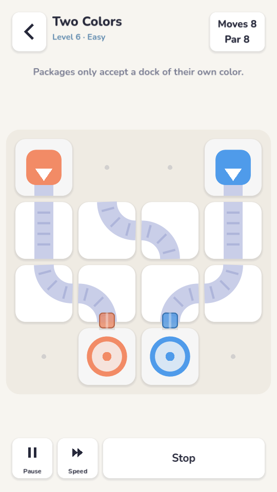

# Loop Factory

A minimalist, offline-first conveyor-belt puzzle game for mobile. Tap belts to rotate them, press
**Run**, and get every package to the dock of its colour — in as few rotations as possible.

* **Game:** Godot 4.3 (GDScript), portrait, one-handed (tap = clockwise, long-press = counter-clockwise)
* **Backend:** Node 22 + TypeScript + Express + Zod + Prisma + PostgreSQL 16
* **Shared rules engine:** TypeScript (canonical, server-side verification) mirrored in GDScript
  (on device), proven identical by ~1,700 parity assertions

| | |
|---|---|
|  |  |

## Features

* 34 curated levels (9 hand-designed teaching levels + 25 reviewed generator levels), each with a
  solver-proven par and a stored, re-verified solution
* Deterministic tick simulation (merges, waiting, deadlocks, loops, crossings, junctions, locked belts)
* Exact minimum-rotation solver (cross-checked against brute force), hints, procedural generator
  for 5 difficulty tiers, endless mode
* Daily puzzle (HMAC-seeded, server-published, replay-verified ranking), weekly and global boards
* Works fully offline; atomic autosave after every move; instant resume; corrupted-save recovery
* Optional cloud sync via an idempotent operation queue; guest accounts; account linking (server side)
* Achievements, statistics, colour-symbol (colourblind) mode, reduced motion, haptics,
  synthesised sound effects
* Privacy: opt-in analytics, data export and account deletion
* Monetisation-ready entitlement model (store verification pending credentials)

## Repository layout

See [docs/architecture.md](docs/architecture.md).
`apps/game` · `services/api` · `packages/engine` · `packages/contracts` · `database` ·
`infrastructure` · `scripts` · `docs` · `.github/workflows`

## Quick start

Prerequisites: Node 22, PostgreSQL 16 (or Docker), Godot 4.3.

```bash
npm ci
cp .env.example .env                       # local dev values
# Database + API (Docker):
docker compose up --build                  # API on http://localhost:8080, /openapi.json
# …or without Docker (Postgres running locally):
export $(grep -v '^#' .env | xargs)
npx prisma migrate deploy --schema database/schema.prisma
npm run db:seed -w @loopfactory/api
npm run dev -w @loopfactory/api

# Game: open apps/game in the Godot 4.3 editor and press Play,
# or run headless tests:
./scripts/test-game.sh
```

The client reads `apps/game/config/client.json` (`apiBaseUrl`, default `http://127.0.0.1:8080`).
Without a reachable server the game simply plays offline.

## Common commands

| Command | Purpose |
|---|---|
| `npm run typecheck` / `npm run lint` | static checks |
| `npm test -w @loopfactory/engine` | rules engine tests |
| `npm test -w @loopfactory/api` | API integration tests (needs Postgres; `TEST_DATABASE_URL`) |
| `./scripts/test-game.sh` | Godot tests (parity, rules, saves) |
| `./scripts/e2e.sh` | client ↔ API end-to-end |
| `npm run levels:build -- --review` | rebuild curated levels and print ASCII renders |
| `npm run fixtures:build` | regenerate TS→GDScript parity fixtures |
| `npm run openapi -w @loopfactory/api` | regenerate `docs/api/openapi.json` |
| `./scripts/build-android.sh debug\|release` | export APKs |
| `godot --path apps/game -- --tour=/abs/out` | screenshot tour of every screen |

## Documentation

| Topic | File |
|---|---|
| Game rules (normative), solver, generator | [docs/gameplay-rules.md](docs/gameplay-rules.md) |
| Architecture & decisions | [docs/architecture.md](docs/architecture.md) |
| Offline persistence & sync/merge rules | [docs/sync.md](docs/sync.md) |
| API | [docs/api.md](docs/api.md), [docs/api/openapi.json](docs/api/openapi.json) |
| Security review | [docs/security.md](docs/security.md) |
| Deployment, backups, rollback, monitoring | [docs/deployment.md](docs/deployment.md) |
| Load test results | [docs/load-testing.md](docs/load-testing.md) |
| Testing | [docs/testing.md](docs/testing.md) |
| Analytics taxonomy | [docs/analytics.md](docs/analytics.md) |
| Monetisation | [docs/monetization.md](docs/monetization.md) |
| Android / iOS release | [docs/release-android.md](docs/release-android.md), [docs/release-ios.md](docs/release-ios.md) |
| Store listing, privacy policy drafts | [docs/store-listing.md](docs/store-listing.md), [docs/privacy-policy.md](docs/privacy-policy.md) |
| **Known limitations & pending integrations** | [docs/known-limitations.md](docs/known-limitations.md) |

## License

Code: proprietary (all rights reserved) unless a license is added. Font: Nunito, SIL Open Font
License 1.1 (`apps/game/assets/fonts/OFL.txt`). All artwork and sounds are original and generated
in code.
