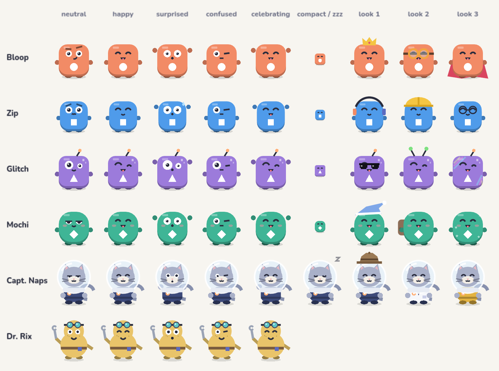

# Character art guide

The sheet above is rendered straight from the game's painter
(`tests_ui/crew_sheet.gd`), so it always matches what ships.

## Status: v1 procedural art, not a final illustration pass

No image-generation tooling was available. Every character is **vector art drawn in code**
(`scripts/crew/crew_painter.gd`), the same way the rest of the game is drawn — there are no image
files. That keeps characters crisp from a 27 px package to a 600 px portrait and costs nothing in
download size, but it is **not** a professional illustrator's final pass. Treat the shapes,
proportions and palette below as the art direction an illustrator should refine; the painter can
later draw textures instead of shapes per body without touching gameplay code.

## Direction

* Premium 2D cartoon: rounded silhouettes, big readable eyes, slightly exaggerated proportions,
  soft two-tone shading (a darker underside and a small highlight).
* Vibrant but controlled: package bodies use exactly the four package colours. Nothing else on a
  board is as saturated as a package, so they stay the focus.
* High contrast against the light boards: dark ink (`#282B3C`) for eyes and mouths, white for the
  symbol and eye whites.
* Readable at small sizes first. Details are added only when there is room for them.
* Originality: rounded package-creatures, a cat in an oversized space helmet and a mustard,
  pear-shaped engineer with pushed-up goggles. No costumes, faces or silhouettes from existing
  franchises. Dr. Rix in particular is deliberately not a lab-coated, spiky-haired scientist.

## Construction (package characters)

Unit space: the body is a rounded square from −0.5 to 0.5; everything is a fraction of it.

| Part | Position / size | Notes |
|---|---|---|
| Body | 1.0 × 1.0, corner radius 0.24 (Glitch) – 0.42 (Mochi) | Zip is drawn at 0.92 scale (smaller, nervous) |
| Underside | body offset +0.07 down, colour darkened 22 % | gives depth like the classic box |
| Highlight | 0.2 × 0.07 at (−0.24, −0.39), white 30 % | |
| Eyes | centres (±0.17, −0.19), radius 0.105 (Zip 0.125; Glitch 0.14 / 0.085 asymmetric) | white, ink pupil, white sparkle |
| Mouth | around (0, −0.04) | smile, smirk, grin, o, flat, wobble, yawn, tongue, whistle |
| Arms / feet | small ovals at the sides / bottom, darker shade | full detail only |
| **Symbol** | **centre (0, 0.25), radius 0.13 (0.17 with "Larger shape symbols")** | **white, drawn last, always** |

Personality features: Bloop has confident brows, Zip worried brows and a sweat drop when
scared, Glitch an antenna and two "pixel" squares, Mochi heavy eyelids and blush.

### The symbol rule

The delivery symbol identifies the package for colour-blind players and is the gameplay
information. It is drawn after everything else, on the body, and its area (a circle of radius
0.27 around the symbol) is reserved: no face part or look may draw there. `tests_ui/crew_ui_tests.gd`
renders every look on every character with and without "Larger shape symbols" and checks that
area pixel by pixel.

## Detail levels

| Level | When (body size) | What's drawn |
|---|---|---|
| Full | ≥ 40 px | everything above, plus the equipped look |
| Compact | 14–40 px | body, underside, dot eyes (blink / happy / wide), symbol at (0, 0.16) radius 0.17 |
| Classic | < 14 px, or characters off | the original package box |

On a 720 px-wide phone, 4×4–5×6 boards run in full detail; the 6×7 boards switch to compact on
short screens (e.g. 720×960). Source pods draw the waiting character larger than a moving
package, so it usually keeps full detail.

## Expressions

Every character supports neutral, happy, surprised, confused and celebrating (Captain Naps also
sleeping), plus the animated states in [CHARACTER_ANIMATIONS.md](CHARACTER_ANIMATIONS.md).
`LFCrewPainter.expression(body, name)` returns the static pose for portraits and banners.

## Looks (cosmetics)

| Slot | Region | Examples |
|---|---|---|
| head | above the body top (y < −0.3) | crown, headphones, helmet, alien antenna, sleep cap |
| eyes | around the eyes only (−0.34 < y < −0.06) | goggles, glasses, pixel sunglasses |
| back | behind the body (drawn before it) | cape, backpack |
| skin | corner patterns only, outside the symbol area | holographic stripes, pajama stars |
| suit | Captain Naps' uniform | lab coat, gold flight suit |
| expression | whole crew, celebration only | starry eyes |

Rules: never recolour the body, never cover the symbol, keep within roughly 0.7 of the body
size so a character never covers a neighbouring tile, and don't draw looks in compact mode.

## Captain Naps

Slate-lavender fur (`#A9B0C8`), cream muzzle, navy uniform (`#3D4A7A`) with an orange badge,
a clear helmet one size too big, heavy-lidded eyes. Compact silhouette: helmet circle over a small
body, tail curling out to the right. Default face is unimpressed half-closed eyes; sleeping adds
a drifting "z". Never drawn on the board itself: Captain Naps appears on Home, banners, cards and the Crew.

## Dr. Rix

Mustard (`#E9C46A`) pear-shaped body, teal goggle lenses pushed up on the forehead, tool belt,
one arm waving a wrench, freckles, a gentle hover. Appears only in banners for mechanic
introductions and in The Crew.

## Handing off to an illustrator

1. Keep the unit grid, symbol position and reserved area exactly.
2. Deliver per body: 5 expressions + the animated states' key poses, at 512 px, flat colours
   matching the palette, plus a simplified compact version.
3. Replace the body branch in `LFCrewPainter.draw_package` with texture draws (or AnimatedSprite
   frames) keyed by expression; keep the symbol drawn last in code.
4. Re-run `tests_ui/crew_ui_tests.gd` (symbol area, colour identity) and the benchmark.
