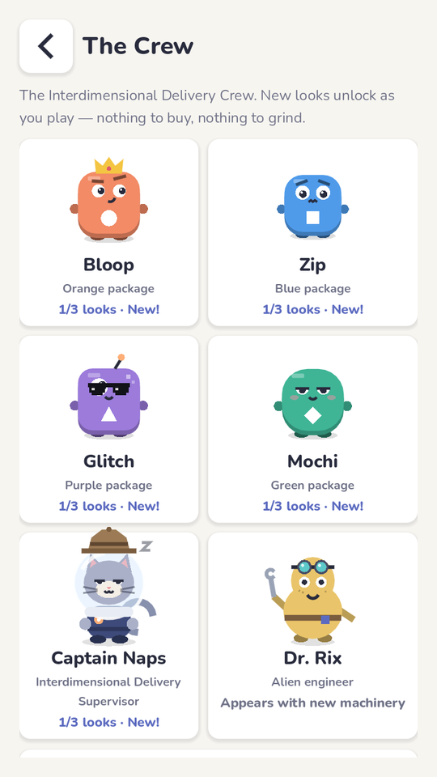
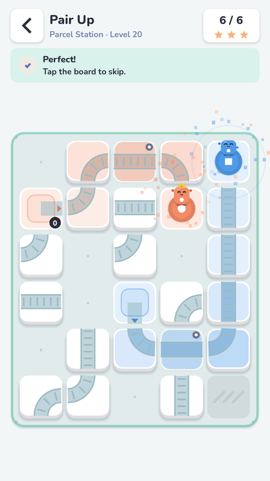
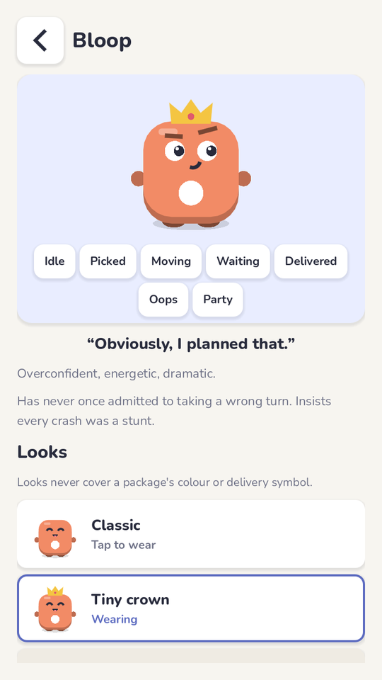

# The Interdimensional Delivery Crew — character system

A dysfunctional delivery company operates across multiple universes. The player solves the
routes; the packages are living creatures who react to everything; a sleepy space cat supervises.
This document covers the audit that shaped the implementation, the architecture, how to add a
character, cosmetics, dialogue, flags, analytics and what is not done.

Related: [CHARACTER_ART_GUIDE.md](CHARACTER_ART_GUIDE.md) ·
[CHARACTER_ANIMATIONS.md](CHARACTER_ANIMATIONS.md) · [CHARACTER_TESTING.md](CHARACTER_TESTING.md)

<p align="center">
  
  
  
</p>

## 1. Audit (before implementation)

| Area | What exists | Consequence for the crew |
|---|---|---|
| Engine / rendering | Godot 4.3, GL Compatibility, 720×1280 canvas. UI built in code; **no image assets** (icons, logo, share card are all drawn). Board = per-tile CanvasItems with appearance signatures ([game-feel.md](game-feel.md)). | Characters are **procedural vector art** drawn in code, the same way. They stay crisp at every size and add no download weight. |
| Rules | Deterministic simulation (TS canonical, GDScript port, parity fixtures). The board only interpolates between frames. | Characters must be a pure *view* of frame state: no timers, physics or randomness that could feed back into the rules. |
| Package identity | 4 colours with a fixed symbol each: orange ●, blue ■, purple ▲, teal ◆. Sources launch, docks receive. | Bloop = 0, Zip = 1, Glitch = 2, Mochi = 3. Colour and symbol never change. |
| Content | 36 campaign levels use **only colours 0–2**; the generator never makes more than 3 routes. | **Mochi (colour 3) never appears on a board today.** Mochi is in The Crew, on Home/share cards and supported by the renderer; a 4-colour world needs separate design and solver validation (not added for theme alone). |
| Save | JSON save merged over defaults on load; sync queue; server strips unknown settings keys. | New `crew` block and settings appear automatically for old saves. Crew settings and equipped looks are **device-local** (the API's settings schema strips them); unlocks are re-derived from synced progress. |
| Progression | Stats + progress per level id; achievements by metric; five worlds by first level id. | Unlock rules read the same data, so existing players get what they already earned. |
| Feature switches | `LFFlags` experiments (control by default, FNV bucketing) from remote config. | Added remote `flags` kill switches and a `presentation` experiment. |
| Analytics | Consent-gated taxonomy, `exp_` properties on every event. | New crew events, deduplicated so they stay cheap. |

### Risks identified and how they were handled

| Risk | Mitigation |
|---|---|
| Faces make small boards unreadable | Two detail levels chosen by pixel size (full ≥ 40 px body, compact below); compact keeps only dot eyes and the symbol. Tested on 720×960 with the 6×7 board. |
| Cosmetics/faces hide the delivery symbol | The symbol is drawn **last**, on the body; looks live in head/eyes/back/skin slots away from it. A pixel test proves the symbol area is unchanged by every look. |
| Animation changes outcomes | Poses are pure functions of frame state; tests compare simulation output and playback length with characters on/off and after running every pose. |
| Extra CPU on budget phones | Characters are pooled canvas items moved by transforms and re-recorded only when the face changes. Measured cost while running: same as the classic boxes ([performance.md](performance.md)). |
| Mascot slows the loop | No modal dialogue anywhere. Lines go into the existing banner, a bubble on Home or one line on the win card; Next stays the biggest button. |
| Glitch's glitch effect looks like wrong movement | Ghost copies are translucent, short (160 ms on a poke, 300 ms on a failure) and never offset more than 8 % of the body; positions come from the simulation only. |
| Copying existing franchises | Original designs: rounded package-creatures, a cat in an oversized helmet, a mustard pear-shaped engineer with goggles — no costumes, faces or silhouettes from other properties. |

## 2. Roster

| Character | Role | Colour / symbol | Personality | Line |
|---|---|---|---|---|
| **Bloop** | Orange package | ● | Overconfident, energetic, dramatic | "Obviously, I planned that." |
| **Zip** | Blue package (slightly smaller) | ■ | Nervous, intelligent, easily startled | "Are we absolutely sure about this?" |
| **Glitch** | Purple package, asymmetric eyes, antenna | ▲ | Chaotic, mischievous | "That was probably supposed to happen." |
| **Mochi** | Green (teal) package, squishy | ◆ | Sleepy, adorable, relaxed | "Five more minutes…" |
| **Captain Naps** | Mascot / supervisor | — | Sleepy, slightly sarcastic, secretly proud | "Wow. The company might survive another day." |
| **Dr. Rix** | Alien engineer | — | Eccentric, enthusiastic | "New machinery! Ninety percent tested." |

## 3. Architecture

```
data/crew/characters.json   roster, styles, cosmetics, unlock rules        (configuration)
data/crew/dialogue.en.json  lines: event, priority, cooldown, probability    (configuration)
scripts/crew/crew.gd        LFCrew: data loading + fallback, presentation switches, unlocks,
                            equip, say(), expose(), Dr. Rix / world introductions
scripts/crew/crew_anim.gd   LFCrewAnim: state machine → pose (pure)
scripts/crew/crew_painter.gd LFCrewPainter: procedural art, detail levels, cosmetics, Naps, Rix
scripts/crew/dialogue.gd    LFDialogue: line selection + localisation fallback (pure)
scripts/crew/moments.gd     LFCrewMoments: shareable moments detected from real results
scripts/ui/crew_portrait.gd LFCrewPortrait: any character as a Control (Home, cards, banner)
scripts/ui/screens/crew.gd  The Crew collection screen
scripts/ui/space_backdrop.gd backdrop for the "full" sci-fi presentation variant
```

**Where characters appear**

| Surface | Behaviour |
|---|---|
| Board – sources | The next package waits in its source like a launch pod: idles, blinks, looks toward the exit. Tap it for a reaction. Shows its failure reaction after a failed run (cleared by any edit, undo, reset or Run). Empty pod once all its packages have left. |
| Board – running | Each package is its character: reacts on spawn, leans and squashes while moving, waits with personality, surprised on a blocked route, confused at a wrong dock, celebrates on delivery. |
| Board – success | Every dock's character hops above its dock together; Glitch spins after a perfect solve; candy world bounces higher. Tap still skips. |
| Banner | Failure banner shows the failing character's confused face and names it ("Bloop hit a belt…"). A repeat of the same failure may add that character's quip. Dr. Rix introduces new mechanics (crossings, junctions, three colours) and Captain Naps new worlds — the level tip stays underneath. |
| Win card | Captain Naps reacts in one line to what actually happened (first win, perfect, all arrived together, near miss, efficient big solve). |
| Home | Captain Naps replaces the logo: idle/asleep, optional bubble with a dismiss button, tap for a new line. Buttons: Worlds · The Crew · Friends. |
| Daily | Captain Naps presents the puzzle; ranking/offline behaviour unchanged. |
| Share card | Crew lineup with the featured character (the colour of the run's final delivery) celebrating, plus one reaction line. No names or private data. |
| Replay | Same characters; celebration replays with the run. |

## 4. Adding a character

1. Add an entry to `data/crew/characters.json`: `id`, `name`, `kind` (`package` / `mascot` /
   `engineer`), `color` (0–3 for packages), `role`, `personality`, `bio`, `line`,
   `style` (`body`, optional `size`, `radius`) and `cosmetics`.
2. A package with an existing body id (or an unknown one, which falls back to the generic
   personality) works immediately: board, Crew screen, portraits, share card.
3. A new **look** for an existing body only needs its own `style.radius/size`. A new
   **personality** adds a `match` branch in `LFCrewAnim` (idle/waiting/failed/delivered) and,
   if it has unique features, a branch in `LFCrewPainter._extras`/`_eye_layout`.
4. Add dialogue lines with `"character": "<id>"`.
5. Run `./scripts/test-game.sh`: the crew tests check identity, unlock reachability, art keys,
   dialogue speakers and that no look touches the symbol.

Package characters are bound to colour indices, so a fifth package character needs a fifth
package colour in the rules first (engine + parity fixtures + generator), which is a gameplay
change, not a character change.

## 5. Cosmetics ("looks") and unlocks

Looks are earned through normal play only. There is nothing to buy and nothing pay-to-win.
They never change colours or symbols, and compact (small-board) characters don't draw them.

| Character | Look (slot) | Unlock (validated against current content) |
|---|---|---|
| Bloop | Tiny crown (head) | Solve 10 campaign puzzles |
| Bloop | Racing goggles (eyes) | Earn 45 stars (of 108) |
| Bloop | Superhero cape (back) | Finish Candy Factory |
| Zip | Headphones (head) | Solve 20 campaign puzzles |
| Zip | Safety helmet (head) | Finish Parcel Station |
| Zip | Tiny glasses (eyes) | Solve 10 puzzles in par |
| Glitch | Pixel sunglasses (eyes) | Earn 30 stars |
| Glitch | Alien antenna (head) | Finish Neon Circuit |
| Glitch | Holographic skin (skin) | Solve 10 endless puzzles |
| Mochi | Sleep cap (head) | Solve 5 campaign puzzles |
| Mochi | Mini backpack (back) | Solve 3 daily puzzles (official or practice) |
| Mochi | Space pajamas (skin) | Finish Space Logistics |
| Captain Naps | Detective hat (head) | Finish Little Workshop (the first world, 9 levels) |
| Captain Naps | Lab assistant coat (suit) | Solve 30 campaign puzzles |
| Captain Naps | Gold flight suit (suit) | Solve every campaign puzzle (36) |
| Everyone | Starry-eyed celebration (expression) | Solve 5 daily puzzles (official or practice) |

Changes from the brief's examples: "Complete 5 daily challenges" counts **offline practice
dailies too**, because official dailies need the server and the game must work offline. Unlock
types: `campaign`, `stars`, `world`, `perfect`, `daily_any`, `endless`, `challenges`,
`all_campaign`.

* Unlocks are evaluated on load, after every completion and after a sync merge
  (`LFCrew.evaluate_unlocks`). They're derived from progress, so an existing save gets its looks
  on first launch and a second device re-derives them from synced progress.
* New looks are marked unseen: The Crew button turns accent-coloured and the card says "New!".
  A short toast appears after the level ("New look for Bloop · Tiny crown") — never a popup.
* Save data: `crew = {equipped: {char: cosmetic}, unlocked: {cosmetic: ms}, seen: {...},
  dialogue: {line: ms}, celebration: ""}`. Unknown references are dropped on load.

## 6. Dialogue engine

Lines live in `data/crew/dialogue.en.json`:

```json
{"id": "naps_perfect_1", "character": "naps", "event": "PERFECT_SCORE",
 "text": "Okay, that was actually impressive.", "priority": 3, "cooldown": 120,
 "probability": 1.0, "anim": "surprised", "when": {"world": "neon"}}
```

* **Events:** `FIRST_LAUNCH`, `HOME_IDLE`, `HOME_TAP`, `LEVEL_START`, `NEW_WORLD`,
  `NEW_MECHANIC`, `FIRST_SUCCESS`, `SUCCESS`, `PERFECT_SCORE`, `UNUSUALLY_EFFICIENT`,
  `ALL_TOGETHER`, `NEAR_MISS`, `FAILED_ATTEMPT`, `DAILY_CHALLENGE`, `CHARACTER_UNLOCK`,
  `COLLECTION`.
* **Selection** (`LFDialogue.pick`, pure): matching event and `when` conditions → cooldown
  expired (`-1` = once ever) → highest priority group → probability gate → least recently shown.
* **Never blocking:** every line goes into an existing surface (banner, bubble, card line).
  `mascot_dialogue_enabled` (remote) and "Captain Naps chatter" (Settings) turn all lines off.
* **Offline:** lines ship in the app; nothing is fetched.
* Templates: `{done}`, `{total}`, `{stars}`, `{name}`.

### Localisation

English is the source. A translation is `dialogue.<lang>.json` with `{"lines": [{"id", "text"}]}`;
missing ids fall back to English per line (tested). The device language picks the file.
**No machine translation:** a Hindi (or other Indian-language) file must be written or reviewed
by a fluent speaker, checked on device for line length (the banner wraps, but bubbles are sized
for ~90 characters), then added. Character names stay untranslated; roster descriptions in
`characters.json` and UI labels are not yet externalised (see known limitations).

## 7. Presentation variants and feature flags

Remote config ([experiments.md](experiments.md)):

```json
{"flags": {"characters_enabled": true, "character_animations_enabled": true,
           "mascot_dialogue_enabled": true, "character_collection_enabled": true,
           "sci_fi_theme_enabled": true},
 "experiments": {"presentation": {"enabled": true, "weights": [34, 33, 33]}}}
```

| Variant | What players see |
|---|---|
| `hybrid` (control, shipped) | Expressive packages, Captain Naps, Dr. Rix, The Crew |
| `minimal` | The pre-crew game: classic boxes, logo on Home, no collection |
| `full` | Hybrid plus a sci-fi backdrop (stars, planet, portal ring) behind Home and the board |

Puzzles, difficulty, scoring, unlock rules and progression are identical in every variant. Player
settings (Character packages, Character animations, Captain Naps chatter) and Reduce motion
apply on top. Note that `hybrid` is the control because it is what ships; the comparison that
measures the crew's effect is `hybrid` vs `minimal` (see [analytics.md](analytics.md)).

## 8. Analytics

New events (consent-gated like everything else, no personal data): `character_exposed`
(once per session per surface), `character_animation_played` (source poke — first per level,
celebration, Home tap, Crew preview), `character_collection_opened`, `cosmetic_unlocked`,
`cosmetic_equipped`, `character_dialogue_shown`, `character_dialogue_dismissed`. The brief's
`level_completed`, `level_retried`, `daily_challenge_completed` and `result_shared` map to the
existing `level_complete`, `level_retry`, `daily_challenge_completed` and `share_completed`.
Queries: [analytics.md](analytics.md#character-system).

**No claim is made that the crew improves retention.** That needs the `presentation` experiment
running against real players.

## 9. Not done / out of scope

* **Final illustrations.** Art is v1 procedural vector art in a consistent direction, not an
  illustrator's final pass ([CHARACTER_ART_GUIDE.md](CHARACTER_ART_GUIDE.md)).
* **Mochi on boards:** no current level uses a fourth colour (see audit).
* **Portals and other new mechanics, additional sci-fi worlds:** not added. Dr. Rix introduces
  existing mechanics only; new mechanics need separate design and solver validation.
* **Character voice audio:** two tiny synthesised sounds (poke "boop", Captain Naps "mrrp"); no
  voice lines.
* **Video export:** replays reuse the existing clean view and screen recorder approach.
* **Cross-device equipped looks / crew settings:** device-local (unlocks re-derive).
* **Device testing:** see [CHARACTER_TESTING.md](CHARACTER_TESTING.md#manual-device-tests).
